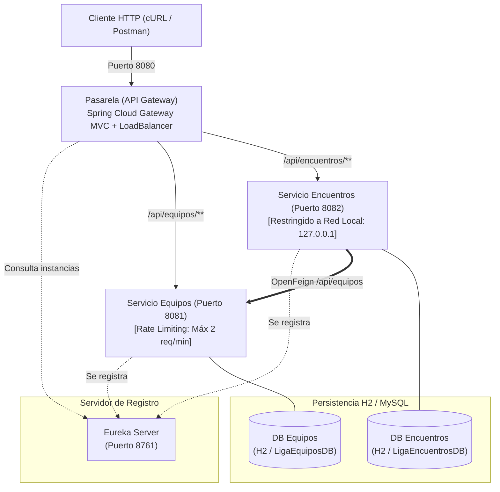

# ⚽ Arquitectura de Microservicios: Liga de Fútbol

Ecosistema distribuido y desacoplado de microservicios basado en **Spring Boot 3.3.5**, **Java 21** y **Spring Cloud 2023.0.3**, con registro centralizado en **Netflix Eureka**, balanceo de carga dinámico con **Spring Cloud Gateway MVC**, comunicación declarativa entre microservicios mediante **OpenFeign**, y políticas de seguridad y control de tráfico.

---

## 🏛️ Componentes y Arquitectura



### Tabla de Microservicios

| Componente | Puerto | Funcionalidad y Políticas Especiales | Tecnologías |
|---|---|---|---|
| **`eureka-server`** | `8761` | Registro y descubrimiento centralizado de servicios | Spring Cloud Netflix Eureka Server |
| **`servicio-equipos`** | `8081` | Gestión del catálogo de equipos de fútbol.<br>🔒 **Rate Limiting (Caso A):** Control de flujo con **Bucket4j** (máx. 2 peticiones por minuto, responde `429 Too Many Requests` a partir de la 3ª solicitud). | Eureka Client, Spring Data JPA, Bucket4j, H2 / MySQL |
| **`servicio-encuentros`** | `8082` | Registro de partidos y cómputo de la tabla de posiciones.<br>🔒 **Restricción a Red Local (Opción A):** Vinculado exclusivamente a `server.address=127.0.0.1` para aislar el microservicio de redes externas públicas. | Eureka Client, OpenFeign, Spring Data JPA, H2 / MySQL |
| **`pasarela`** | `8080` | API Gateway único de entrada que enruta dinámicamente (`lb://servicio-equipos` y `lb://servicio-encuentros`) | Spring Cloud Gateway MVC, Spring Cloud LoadBalancer |

---

## 🚀 Guía Rápida de Compilación y Ejecución

### 1. Compilación
El proyecto incluye el Maven Wrapper en cada carpeta para que no requiera instalar Maven globalmente:

```bash
(cd eureka-server && ./mvnw clean package -DskipTests)
(cd servicio-equipos && ./mvnw clean package -DskipTests)
(cd servicio-encuentros && ./mvnw clean package -DskipTests)
(cd pasarela && ./mvnw clean package -DskipTests)
```

### 2. Puesta en Marcha (en terminales separadas o en segundo plano)
```bash
# 1. Servidor de Descubrimiento (Puerto 8761)
java -jar eureka-server/target/eureka-server-0.0.1-SNAPSHOT.jar

# 2. Microservicio de Equipos (Puerto 8081)
java -jar servicio-equipos/target/servicio-equipos-0.0.1-SNAPSHOT.jar

# 3. Microservicio de Encuentros (Puerto 8082)
java -jar servicio-encuentros/target/servicio-encuentros-0.0.1-SNAPSHOT.jar

# 4. API Gateway / Pasarela (Puerto 8080)
java -jar pasarela/target/pasarela-0.0.1-SNAPSHOT.jar
```

---

## 🧪 Pruebas y Evidencias

- **Script Automatizado:**
  Ejecuta la batería de pruebas REST completa en terminal:
  ```bash
  ./test_microservicios.sh
  ```
- **Colección Postman:**
  Importa el archivo [`Liga_Futbol_Microservicios.postman_collection.json`](./Liga_Futbol_Microservicios.postman_collection.json) directamente en Postman para probar todos los endpoints y validaciones.
- **Documento para Reporte de Laboratorio y Capturas:**
  Revisa la [`GUIA_PRUEBAS_Y_CAPTURAS.md`](./GUIA_PRUEBAS_Y_CAPTURAS.md), la cual describe paso a paso cómo probar cada requerimiento e incluye recuadros listos para insertar capturas de pantalla de evidencias.

---

## 🗄️ Persistencia en MySQL y Visualización en phpMyAdmin

Por defecto, los microservicios se inician con la base de datos embebida **H2 en memoria** (`jdbc:h2:mem:...`).

Para persistir en tu servidor **MySQL / MariaDB local (puerto 3306)** y visualizar las tablas en phpMyAdmin:

1. Inicia los servicios con el perfil activo de MySQL:
   ```bash
   java -jar servicio-equipos/target/servicio-equipos-0.0.1-SNAPSHOT.jar --spring.profiles.active=mysql
   java -jar servicio-encuentros/target/servicio-encuentros-0.0.1-SNAPSHOT.jar --spring.profiles.active=mysql
   ```
2. Levanta phpMyAdmin con Docker en un solo comando:
   ```bash
   docker run -d --name phpmyadmin -p 8085:80 -e PMA_HOST=127.0.0.1 -e PMA_PORT=3306 phpmyadmin/phpmyadmin
   ```
3. Ingresa a [http://localhost:8085](http://localhost:8085) (Usuario: `root`, sin contraseña) y visualiza las bases de datos `LigaEquiposDB` y `LigaEncuentrosDB`.
